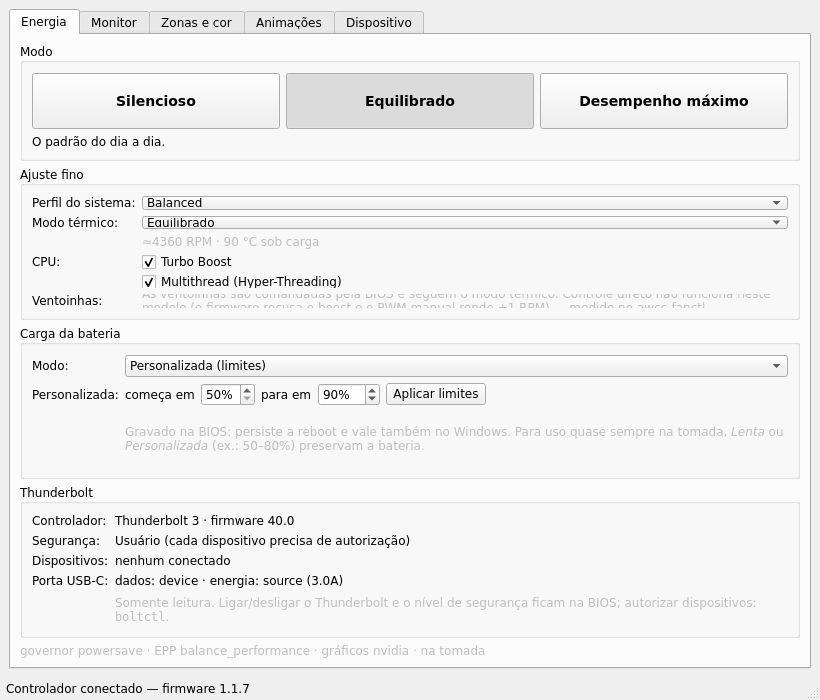
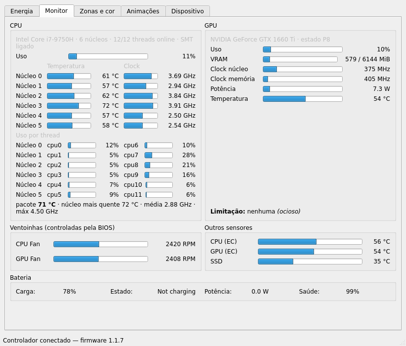
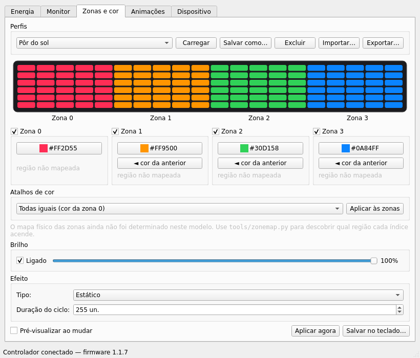
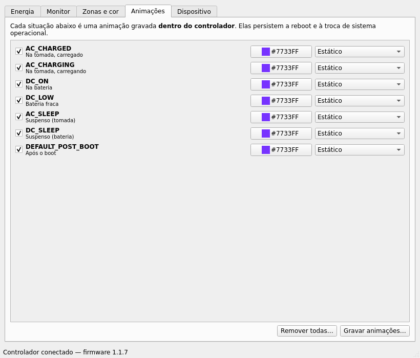
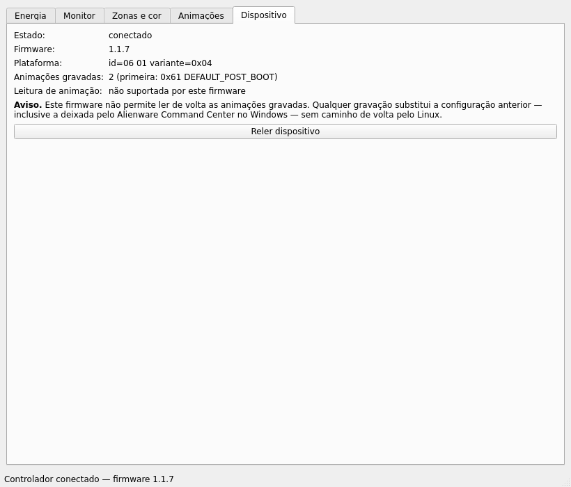

# awelc-ctl

Controle do backlight RGB de teclados Alienware/Dell G-Series no Linux, falando
direto com o controlador USB **AW-ELC `187c:0550`**.

Escrito e validado num **Dell G5 5590** — modelo que os projetos existentes não
cobriam.

Desde a 0.4.0 é também uma **central de controle** no espírito do Alienware
Command Center: modos de energia prontos, modo térmico do firmware, Turbo Boost, multithread (SMT),
carga da bateria e monitor de temperaturas, ventoinhas e GPU. Ver
[Energia e desempenho](#energia-e-desempenho).

## Por que existe

O RGB desses teclados não é um LED do kernel. É um dispositivo USB HID separado,
sem driver: não há `/sys/class/leds/dell::kbd_backlight` nas variantes RGB, e o
`alienware_wmi` não cria device algum para iluminação. Sem software em espaço de
usuário, não há controle nenhum.

Já existiam dois projetos para isso —
[G15kblight-cli](https://github.com/Vescrity/G15kblight-cli) e
[Dell-G-Series-Controller](https://github.com/cemkaya-mpi/Dell-G-Series-Controller),
ambos GPL-3.0 — mas mirando o Dell G15. Este aqui parte deles e acrescenta:

- **Reanexação garantida do `usbhid`.** O upstream desanexa o driver do kernel e
  nunca religa, deixando o dispositivo órfão até o próximo replug. Aqui isso vive
  num context manager com `finally`.
- **Zonas e brilho na linha de comando.** O protocolo sempre suportou os dois; as
  CLIs existentes é que não expunham.
- **Modo somente-leitura verificável.** `AwelcDevice(read_only=True)` recusa em
  tempo de execução qualquer comando fora da classe de consulta `0x20`.
- **Pré-visualização que realmente funciona.** `SET_COLOR` sozinho é repintado
  pelo motor de animação do controlador — a cor pisca e volta ao padrão. A
  solução é encerrar a montagem com `FINISH_PLAY` em vez de `FINISH_SAVE`, o que
  substitui a animação em execução sem gravar nada. Os dois projetos upstream
  têm essa função no código e nunca a chamam.
- **Protocolo documentado a partir de medição**, incluindo dois comandos que a
  documentação implica existirem e que este firmware simplesmente não tem.

## Instalação

### Debian, Ubuntu, Pop!_OS e derivados

Baixe o `.deb` da [página de releases](https://github.com/ahpqmiranda/awelc-ctl/releases):

```bash
sudo apt install ./awelc-ctl_0.4.0_all.deb
```

Instala a biblioteca, a CLI, a regra udev, o atalho do menu e o helper de
energia com sua política polkit, e recarrega o udev sozinho. Desinstala com `sudo apt remove awelc-ctl`.

A interface gráfica precisa do PySide6. No Ubuntu 24.04+ ele vem do repositório
(`Recommends`, instalado junto); no 22.04 ainda não existe empacotado, então
use `pip install --user PySide6`. A linha de comando funciona sem ele.

### A partir do código

```bash
git clone <url> awelc-ctl && cd awelc-ctl
uv venv && uv pip install -e ".[gui]"     # ou: python3 -m venv .venv && .venv/bin/pip install -e ".[gui]"
```

Sem a extra `[gui]` você fica só com a linha de comando, sem depender do Qt.

Para usar sem `sudo`, instale a regra udev:

```bash
sudo cp udev/60-awelc.rules /etc/udev/rules.d/
sudo udevadm control --reload-rules && sudo udevadm trigger
```

Sem ela, o dispositivo é `root:root` e todo comando falha com *"sem permissão"*.
Alternativa pontual, sem tocar no sistema: `pkexec .venv/bin/awelc …`

## Energia e desempenho

### Modos prontos

| Modo | system76-power | Modo térmico | Turbo |
|---|---|---|---|
| **Silencioso** | `Battery` | `quiet` | desligado |
| **Equilibrado** | `Balanced` | `balanced` | ligado |
| **Desempenho máximo** | `Performance` | `performance` | ligado |

```bash
awelc power status               # estado atual (não escreve nada)
awelc power preset desempenho    # silencioso | equilibrado | desempenho
awelc power thermal performance  # só o modo térmico do firmware
awelc power turbo off
awelc power smt off          # multithread (Hyper-Threading), sem ir à BIOS
awelc power charge Custom --start 50 --end 80
```

O perfil do `system76-power` vai **antes** do modo térmico. Ao trocar de
perfil, o `system76-power` também mexe no `platform_profile`, e nesse
movimento deixa os dois handlers do firmware discordando: medido em
2026-10-26, `Performance` deixou `alienware-wmi` em `balanced-performance` e
`dell-pc` em `performance`, e a interface agregada passou a reportar `custom`.
O preset grava o modo térmico por cima, pela interface agregada, e realinha os
dois.

Esse `custom` **não é discordância real**: é só diferença de nome. Gravar
`performance` na agregada produz exatamente esse par (reproduzido em
2026-10-28), e `awelc power status` e a GUI mostram "Desempenho". "Misto" fica
para quando os handlers discordam de verdade, como `quiet` contra `performance`.

### As ventoinhas não têm controle — e isso é medido, não descuido

Não há botão de ventoinha. O projeto irmão
`awcc-fanctl` mediu as três interfaces neste modelo:

| Interface | Resultado |
|---|---|
| `fanN_boost` (`alienware_wmi`) | o firmware recusa toda escrita (`EBADRQC`) |
| `pwmN` (`dell_smm`) | manual em 255 rendeu +1 RPM sobre a BIOS |
| `platform_profile` | funciona — de ≈4120 RPM (`cool`) a ≈4930 RPM (`performance`) |

O modo térmico governa o **limite de potência da CPU**; a ventoinha responde
ao calor resultante. É por isso que a aba Energia mostra, ao lado de cada modo,
a rotação e a temperatura medidas sob carga.

### O que exige root, e como

Modo térmico, turbo, SMT e carga da bateria são escritas em sysfs de root. Elas
passam por um helper pequeno, [`power_helper.py`](src/awelc/power_helper.py):

- só biblioteca padrão, rodando com `/usr/bin/python3 -I`;
- lista fechada de operações (`thermal`, `turbo`, `smt`, `charge-type`,
  `charge-thresholds`), com todos os argumentos validados **antes** da
  primeira escrita;
- nenhum caminho vem da linha de comando — os atributos são achados pelo nome
  do driver.

Instalado em `/usr/libexec/awelc-ctl/awelc-power-helper` e liberado pela ação
polkit `io.github.ahpqmiranda.awelc-ctl.power`: **sem senha para a sessão local
ativa**, com senha de administrador para sessões remotas ou inativas. O perfil
do sistema não passa pelo helper — o `system76-power` já aceita a chamada do
usuário pelo DBus.

Instalação a partir do código (o `.deb` já faz isso):

```bash
awelc power install     # imprime o comando; ou o botão na aba Energia
```

O modo térmico, o turbo e o SMT voltam ao padrão no reboot. O **modo de carga da
bateria é gravado na BIOS** e persiste, inclusive no Windows.

## Interface gráfica

```bash
awelc-gui        # ou: python -m awelc.gui
```

Abas de energia:

- **Energia** — os três modos prontos, ajuste fino (perfil do sistema, modo
  térmico, turbo, multithread), carga da bateria e o estado do Thunderbolt
  (somente leitura). Avisa quando os handlers do firmware
  discordam.
- **Monitor** — atualizado a cada 2 s:
  - **CPU por núcleo físico:** temperatura (`coretemp`) e clock. O clock do
    núcleo é o da thread mais rápida entre as duas que ele roda; o clock de
    cada thread aparece ao passar o mouse sobre o nome do núcleo.
  - **GPU:** uso, VRAM usada/total, clock do núcleo e da memória (escalados
    pelo máximo que o `nvidia-smi` reporta), potência e temperatura.
  - Ventoinhas, temperaturas do EC e do SSD, e bateria.





Abas do backlight:

- **Zonas e cor** — uma carta por zona, com liga/desliga e seletor de cor;
  teclado ilustrativo (as faixas ainda não refletem o mapa físico); atalhos
  de cor (cor única, arco-íris, degradê, espelhar, copiar da zona anterior) e
  cores recentes; **perfis** salvos em `~/.config/awelc-ctl/profiles/`, com
  importar e exportar `.json`; slider de brilho com chave geral; efeito
  (estático, fade/morph, pulse) e duração do fade. Pré-visualização volátil
  enquanto você mexe, e um botão separado para gravar no controlador.
- **Animações** — as sete situações que o controlador reconhece (na tomada,
  na bateria, suspenso, bateria fraca, pós-boot), cada uma com cor e efeito
  próprios.
- **Dispositivo** — firmware, plataforma, quantas animações estão gravadas, e
  se este firmware permite lê-las de volta.







Se faltar permissão, aparece uma faixa no topo com um botão que instala a regra
udev via `pkexec` — o app em si nunca roda como root.

A gravação pede confirmação explícita, explicando que é irreversível, com opção
de não perguntar de novo.

## Uso pela linha de comando

```bash
awelc info                        # identifica o controlador (não escreve nada)

awelc color 7733FF                # cor sólida, volátil
awelc color 7733FF --persist      # grava no controlador, sobrevive a reboot
awelc color FF0000 --zones 0,1    # só nas zonas 0 e 1

awelc brightness 60               # 0 = apagado, 100 = máximo
awelc off                         # apaga

awelc morph 7733FF                # ciclo de cores
awelc clear --yes                 # remove todas as animações gravadas
```

## ⚠️ Antes da primeira escrita, leia isto

O controlador guarda animações **dentro do próprio hardware**. Elas persistem a
reboot e a troca de sistema operacional — se você já usou o Alienware Command
Center no Windows, a configuração dele está gravada aí.

**Este firmware não permite lê-las de volta.** Os comandos `GET_ANIMATION_BY_ID`
e `READ_SERIES` retornam "não suportado" (detalhes e evidência em
[`docs/protocol.md`](docs/protocol.md)). Não existe backup possível pelo Linux.

Portanto: **a primeira escrita destrói a configuração anterior de forma
irreversível.** Recuperá-la exigiria o Windows com o ACC. Nada disso toca BIOS ou
firmware — o pior caso é reconfigurar a iluminação do zero.

`awelc info` é seguro e não escreve nada.

## Estado

| Recurso | Situação |
|---|---|
| Identificação do controlador | ✅ validado no G5 5590 |
| Interface gráfica PySide6 | ✅ funcional |
| Brilho (`DIMMING`) | ✅ validado no hardware |
| Cores diferentes por zona | ✅ validado no hardware |
| Cor aplicada sem ser repintada pela animação | ✅ o mecanismo funciona (ver ressalva abaixo) |
| Estabilidade da cor ao longo do tempo | ⚠️ **inconsistente** — ver limitações |
| Cor persistente (`--persist`) | ⚠️ implementado, nunca exercitado |
| Efeitos (rainbow, breath, pulse) | ⚠️ implementados, semântica não resolvida |
| Mapa físico de zonas | ❌ não documentado — ver `tools/zonemap.py` |
| Tecla de backlight do notebook | ❌ não corrigível em espaço de usuário |
| Leitura de energia e monitor | ✅ validado no G5 5590 |
| Perfil do system76-power | ✅ validado no G5 5590 |
| Modo térmico (escrita pelo helper) | ✅ validado no G5 5590: `balanced` e `performance` gravados via pkexec e lidos de volta |
| Helper de energia (turbo, SMT, carga) | ⚠️ testado contra sysfs falso; escrita real como root ainda não exercitada |
| Controle de ventoinha | ❌ não existe neste firmware — ver `awcc-fanctl` |

## Limitações conhecidas

Honestidade sobre o que não fechamos:

**A cor às vezes pisca.** O mecanismo do `FINISH_PLAY` resolve a disputa com a
animação gravada — isso está comprovado. Mas em observações posteriores, uma cor
estática pelo mesmo caminho e com os mesmos parâmetros ora ficou firme, ora
apresentou blink periódico. Há uma variável não controlada.

O suspeito principal é o parâmetro `loop` do `START_SERIES`, fixado em `1` desde
o upstream e nunca questionado por ninguém. Se ele for contagem de repetições, a
animação termina e reinicia, o que produziria exatamente o blink observado. Não
chegamos a concluir o teste.

**A semântica de `tempo` e `duration` é desconhecida.** O upstream fixa
`tempo=TEMPO_MIN` (`0x01`) sem explicar. Variamos entre 1, 64 e 255 sem
conseguir mapear o resultado com confiança.

**Os nomes dos efeitos podem estar errados.** O que o upstream chama de "morph"
é rotação dos canais RGB, que na prática produz um ciclo de cores — o *rainbow*
do Alienware Command Center, não um fade. O efeito `PULSE` (`0x01`) nunca foi
exercitado por ninguém e é candidato a ser o *breath* do ACC (pulsa no brilho
máximo, decai até apagar, volta), mas isso não foi confirmado.

`tools/diag_effects.py` e `tools/diag_revert.py` estão no repositório para quem
quiser retomar essa investigação.

Sobre a tecla: ela emite um evento WMI (`type 0x0012`) que o `dell_wmi` descarta
antes de chegar ao evdev. Não dá para mapear por `hwdb` nem `setkeycodes` —
exigiria patch no kernel. Contorno: vincular um atalho do desktop a `awelc off`.

## Gerar o pacote

```bash
./packaging/build-deb.sh     # -> dist/awelc-ctl_<versão>_all.deb
```

Precisa só de `dpkg-deb` e `fakeroot`.

## Atalho no menu (instalação a partir do código)

```bash
cp packaging/awelc-gui.desktop ~/.local/share/applications/
update-desktop-database ~/.local/share/applications
```

## Contribuindo — procuram-se outros modelos

O controlador `187c:0550` aparece em muitos **Dell G3, G5, G7, G15, G16 e
Alienware**, mas só o G5 5590 foi validado até agora. Cada modelo tem topologia
de zonas própria e o firmware varia.

Se você tem um desses, o relatório sai pronto com um comando:

```bash
.venv/bin/python tools/collect_report.py -o relatorio.md
```

Somente leitura — não altera a iluminação nem grava nada. Veja
[`CONTRIBUTING.md`](CONTRIBUTING.md) para o passo a passo e para as perguntas de
protocolo ainda em aberto.

## Documentação

- [`docs/protocol.md`](docs/protocol.md) — o protocolo ELC medido, comando a comando
- [`docs/g5590.md`](docs/g5590.md) — particularidades do modelo, permissões, mapa de zonas
- [`docs/probe-g5590-firmware-1.1.7.json`](docs/probe-g5590-firmware-1.1.7.json) — respostas cruas da sondagem inicial
- [`CHANGELOG.md`](CHANGELOG.md) — o que mudou e o que ficou em aberto

## Licença

GPL-3.0-or-later, herdada dos projetos dos quais deriva.
